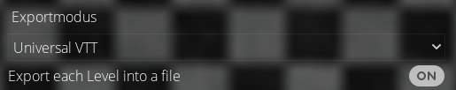
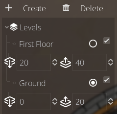

# Foundry VTT-UVTT-Dungeondraft-Importer for Foundry v14 - Dungeondraft Animated Door Version

Allows importing Universal VTT map files into FoundryVTT.

## About this Version

Install this module manually by pasting this link in your Foundry module Manifest URL input field:

https://github.com/CePeU/FVTT-UVTT-Animated-Doors-importer-v14/releases/download/1.1.0/module.json

This is a fork under MIT license of the Foundry VTT Universal Battle Map importer.

https://github.com/moo-man/FVTT-DD-Import/

That module is flagged as no AI content. While I did purposfully not use AI for this importer (which probably can be derived from my bad coding) to allow to push my changes back into the original fork - if so desired at one point. I did use AI to create the Animated Door mod for Dungeondraft which allows this mod to import UVTT files which have been modded to entail the necessary informations for animated doors.
Dungeondraft does the heavy lifting of creating the data necessary and this fork is adjusted to allow for the import of that data.

From version 1.1.0 on the Dungeondraft animated doors mod should also integrate an export of levels seamlessly into this version of the Universal Battlemap Importer.
Be aware that to keep compatibility with the former working of the Universal Battlemap Importer you need to export each level from Dungeondraft as a seperate UVTT file.

Choose this setting:

As my plugin for Dungeondraft is a bit of a special thing and I do not want to start a discussion about AI usage I forked this module to make it work with my animated doors Dungeondraft mod.

I took great care to make this work but time is an issue and this code is not all of my own. If you experience a bug you are very welcome to open an issue on this github or to contact me in the Dungeondraft discord under my handle CePeU (cepeu1).

https://discord.com/invite/6Ak9sZQ

Be aware that I tried to keep backward compatibility to the v14 version of this Foundry module. Level import is possible since version 1.1.0 but not yet tested very well (which means it works for me but I am sure somebody will be able to break it). If you find a but let me know - I will try to fix it. That way everybody using this can profit from it.

In the Dungeondraft mod animated doors you can set the hight levels in the levels setting like this:

## Usage Instructions

1. Export your map with the Universal VTT option in [DungeonFog](https://dungeonfog.com/), [Dungeondraft](https://dungeondraft.net/), [Arkenforge](https://arkenforge.com), or [AutoWall](https://autowallvtt.com/).
2. Go to the scene tab in FVTT, click the _Universal Battlemap AD Import_ button.
3. Fill in the scene name, a path to where the image is to be saved, and the fidelity/offset options.  
   a. **Fidelity**: How many cave walls are used. Far left - less walls, better performance, Far right - more walls, worse performance  
   b. **Offset**: How much to nudge the walls away from the edge.

If you don't use S3, make sure the storage type is set to User Data and ignore the S3 fields. 4. Click Import.
